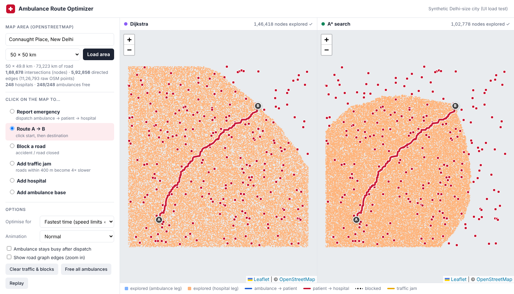

# Ambulance Route Optimizer: Dijkstra vs A* on real Delhi roads

An ADA (Analysis & Design of Algorithms) project. The road network of
**Central Delhi (50 km × 50 km around Connaught Place)** is downloaded from
**OpenStreetMap**. When an emergency is reported, the program finds:

1. the **nearest available ambulance** and its fastest route to the patient
2. the fastest route from the patient to the **nearest hospital**

Every search is run with **both Dijkstra's algorithm and A\***, written from
scratch, and the two are compared side by side on a live map: nodes explored,
edges relaxed, heap operations and runtime. You can block roads or add traffic
jams and watch both algorithms re-route.


*A 57 km route on a Delhi-sized test city: Dijkstra (left) searches in every direction, while A\* (right) searches an ellipse towards the destination. On your machine the OpenStreetMap map appears underneath.*

---

## 1. Setup

You need Python 3.9 or newer.

```bash
pip install -r requirements.txt
```

## 2. Run

```bash
python main.py web
```

* **First run:** the program downloads Central Delhi from the OpenStreetMap
  Overpass API in 25 tiles of 10 × 10 km and then builds the road graph. Expect
  **several minutes**, depending on your internet and the Overpass
  server's load, and about **2–3 GB of RAM** while building. Every finished tile is saved in
  `data/cache/`, so if the download is interrupted, just run the command again
  and it resumes.
* **Every run after that:** the prepared graph loads from cache in a few seconds.
* Your browser opens **http://127.0.0.1:5000**.

Other ways to run it:

```bash
python main.py web --size 10                       # smaller 10x10 km Delhi (fast first download)
python main.py web --place "Koramangala, Bengaluru" --size 8
python main.py web --center 28.5672,77.2100 --size 20
python main.py web --osm-file map.osm              # offline: area exported from openstreetmap.org
python main.py web --sample                        # tiny bundled offline map (no internet needed)

python main.py dispatch --incident 28.6315,77.2167     # text-mode emergency
python main.py route --from 28.6315,77.2167 --to 28.5672,77.2100
python main.py benchmark                               # experiments + charts for the report
python -m pytest -q                                    # 19 unit tests
```

### Using the map

| Mode | Click on the map to… |
|---|---|
| **Report emergency** | dispatch: ambulance → patient (blue) → hospital (red) |
| **Route A → B** | click a start point, then a destination |
| **Block a road** | close the road you click (accident). The last query is re-routed automatically |
| **Add traffic jam** | roads within 400 m become 4× slower, then re-route |
| **Add hospital / ambulance base** | add your own |

The left map runs Dijkstra and the right map runs A\*. Both animate at the same
speed (nodes per frame), so you can **see** that A\* finishes first and searches
a much narrower area. The dots are the nodes each algorithm explored. Tick
"Show road graph edges" and zoom in to see the actual graph.

---

## 3. How it works

### Graph model (`aro/graph.py`)

| Real world | Graph |
|---|---|
| road intersection | vertex |
| road stretch between two intersections | directed edge (two for two-way roads, one for one-way) |
| travel time = length ÷ speed limit × traffic factor | edge weight |

* Speed comes from the OSM `maxspeed` tag. If a road has none, a typical Indian
  urban speed for its road class is used (e.g. trunk 60, primary 50,
  residential 25 km/h).
* **Simplification:** OSM stores every bend of a road as a point. Delhi has
  over a million of them. Chains of "pass-through" points (exactly two
  neighbours) are contracted into one edge that keeps the road's shape for
  drawing. Shortest-path distances are **unchanged** (verified in the tests),
  but the graph becomes 3–7× smaller.
* **Largest strongly connected component** (Kosaraju, O(V + E)): only nodes
  that can reach, and be reached from, every other node are kept, so every
  query has an answer.

### Dijkstra (`aro/algorithms.py`)

The classic algorithm with a binary min-heap (`heapq`) and lazy deletion. It
stops as soon as a target is popped from the heap.

### A\*

Same loop, but the heap is ordered by `f(n) = g(n) + h(n)`:

* `g(n)` is the best known travel time from the start to n
* `h(n)` is the straight-line distance from n to the target ÷ the highest speed
  limit in the city

`h` never overestimates: no road is shorter than the straight line, and no
ambulance drives faster than the top speed limit. So it is **admissible**, and
A\* still returns the **optimal** route. It is also **consistent**
(`h(u) ≤ w(u,v) + h(v)`), so every node is settled at most once. The tests
check both properties on every edge of a real map.

The straight-line distance is computed on a flat local projection, which is
much cheaper than the haversine formula. It is then multiplied by 0.99 so it
stays a strict lower bound despite the tiny projection error.

### Dispatch (`aro/dispatcher.py`)

* **Nearest hospital:** a **multi-target** search. All hospitals are targets,
  and the first one popped from the heap is the nearest. For A\*,
  `h(n) = min over hospitals`.
* **Nearest ambulance:** one search on the **reversed graph**, starting from
  the patient. With one-way streets, "time from ambulance to patient" is not
  the same as "time from patient to ambulance". Searching backwards along
  reversed edges answers the right question in a single search instead of one
  search per ambulance.

### Complexity

| | Time | Space |
|---|---|---|
| Dijkstra (binary heap) | O((V + E) log V) | O(V) |
| A\* (consistent heuristic) | O((V + E) log V) worst case; in practice explores only an ellipse around the route | O(V) |
| SCC (Kosaraju) | O(V + E) | O(V) |
| Graph simplification | O(V + E) | O(V + E) |
| Nearest node (grid index) | O(1) average | O(V) |

### What the experiments show (`python main.py benchmark`)

* Both algorithms always return the same cost. Optimality is checked on every
  query.
* A\* explores far fewer nodes, and its advantage **grows with trip length**
  (`nodes_vs_distance.png`).
* The gain is larger for "shortest distance" than for "fastest time". For
  time, the heuristic must divide by the top speed in the whole city (an
  expressway), which makes it a looser lower bound for slow local roads
  (`speedup_by_metric.png`). This trade-off is a good point to discuss in your
  report.
* On very short trips A\* can be slower in milliseconds, because computing h
  costs more than the few nodes it saves.

---

## 4. Project structure

```
main.py                    command-line entry point
aro/
  osm_loader.py            OpenStreetMap download (Overpass API, tiled + cached), .osm file parser
  graph.py                 road graph: build, simplify, SCC, weights, traffic, spatial lookup
  algorithms.py            Dijkstra, A*, Bellman-Ford (test reference)
  dispatcher.py            nearest ambulance / nearest hospital
  area.py                  area presets (Central Delhi) + graph cache
  benchmark.py             experiments + matplotlib charts
  geo.py                   haversine, grid spatial index
  web/                     Flask server + Leaflet front end (Leaflet bundled, works offline)
tests/test_core.py         unit tests
sample_data/               small real OSM extract for offline demos
data/cache/                downloaded tiles + prepared graphs (created on first run)
```

## 5. Troubleshooting

* **"server busy (HTTP 429/504)"**: the public Overpass server is overloaded.
  The program retries automatically and tries other mirrors. If it still
  fails, run the command again later; finished tiles are kept.
* **Laptop low on memory?** Start with `--size 20` or `--size 10`.
* **Map tiles not showing**: the background map needs internet. The algorithms
  work without it.
* By default **service roads** (lanes inside campuses, parking roads) are left
  out to keep the 50 km graph manageable. Add `--include-service` to include
  them.

Map data © OpenStreetMap contributors, available under the Open Database
License (ODbL).
